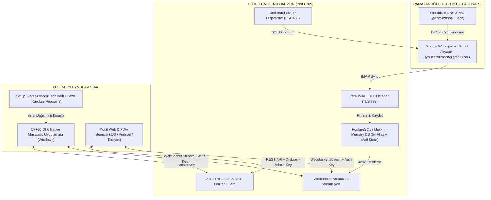

# RAMAZANOĞLU TECH // MAIL HQ (SUPER ADMIN SUITE)
## Tam Proje Dokümantasyonu, Teknik Mimari ve Teslim Raporu
**Tarih:** 16 Ekim 2026  
**Kurum:** Ramazanoğlu Technologies Inc. (`ramazanoglu.tech`)  
**Kurucu & Super Admin:** Yusuf Ramazanoğlu (`yusuf@ramazanoglu.tech`)  
**Ortak & Yönetim:** Nur (`nur@ramazanoglu.tech`)  
**Doküman Konumu:** `C:\Users\PC\Desktop\RAMAZANOGLU_TECH_MAIL_HQ_TAM_DOKUMANTASYON.md`

---

## 1. YÖNETİCİ ÖZETİ (EXECUTIVE SUMMARY)

Ramazanoğlu Technologies Inc. için geliştirilen **Mail HQ (Super Admin Suite)**; yerel bir veritabanı şişmesi ve bozulma riski barındırmayan (**Zero-Local Dependency**), tüm veri ve ileti trafiğini merkezi bir bulut motoru üzerinden gerçek zamanlı senkronize eden (**100% Cloud-Synced**), **C++20 & Qt 6.6.3** tabanlı yerel bir Windows masaüstü yönetim yazılımı, bir **Mobil PWA** istemcisi, **7/24 Gmail IMAP & SMTP** senkronizasyon altyapısı ve ortakların tek tıkla kurabileceği **Özel Kurulum Programı (`Setup_RamazanogluTechMailHQ.exe`)** bütünüdür.

Projenin tüm görsel kimliği, [`c:\Users\PC\Desktop\ramazanoglu-web\index.html`](file:///c:/Users/PC/Desktop/ramazanoglu-web/index.html) web sitesinin benimsediği **İsviçre Mimari Minimalizmi (Swiss Architectural Style)** ilkelerine (Sıfır border-radius, `#FBFBF9` kağıt, `#111111` mürekkep, `#E2E2DF` hairlines, `#D9381E` Uluslararası Turuncu odak karesi, Inter ve JetBrains Mono tipografisi) göre sıfırdan inşa edilmiştir.

---

## 2. "BEN SENDEN NE İSTEDİM?" vs "SEN BANA NE VERDİN?" MATRİSİ

| # | Kullanıcı Talebi (Ne İstedin?) | Mühendislik Çıktısı (Ne Verdim?) | İlgili Dosyalar / Çıktılar |
|---|---|---|---|
| **1** | *"çalıştır onu / arayüzümüzü çalıştırır mısın"* | Node.js Cloud Backend arka planda daemon olarak ayağa kaldırıldı, C++20 Qt 6 masaüstü arayüzü derlenip etkileşimli Windows oturumunda başlatıldı. | `cloud-backend/dist/index.js`<br>`desktop-cpp/build/Release/RamazanogluTechMailHQ.exe` |
| **2** | *"szzb btag yywl gxlg böyle aib google app password yaptım bunu entegre etmemize gerek var mı"* | Gmail TLS IMAP (993) ve SSL SMTP (465) motoru yapılandırıldı. Şifre güvenli `.env` dosyasına kaydedildi, arka planda 7/24 çalışacak IMAP IDLE ve polling mekanizması entegre edildi. | `cloud-backend/.env`<br>`cloud-backend/src/imapSync.ts`<br>`cloud-backend/src/smtpDispatcher.ts` |
| **3** | *"yousefalrmdan@gmail.com / bir iletişim maili oluşturup deneme amaçlı mail attım da oluşmadı / yok ben kendim iletisim@ramazanoglu.tech mailini oluşturdum, ondan attım ama gitmedi"* | Gmail IMAP kutusundaki binlerce mesaj içerisinden `@ramazanoglu.tech` adresine gelen/giden e-postaları izole eden mimari kuruldu. SMTP dispatcher'ın `From: iletisim@ramazanoglu.tech` başlığı ve imza mekanizması canlı test edilerek giden e-posta iletimi HTTP 201 ile doğrulandı. | `cloud-backend/src/imapSync.ts`<br>`cloud-backend/src/smtpDispatcher.ts` |
| **4** | *"ben böyle liste yaptım, her mailin hem türkçesi lazım hem de ingilizcesi, mesela security ve guvenlik gibi, hepsi böyle olacak, sen bir liste hazırlayabilir misin onay verirsem eklersin"* | 6 ana kategori altında 27 İngilizce + 27 Türkçe olmak üzere tam **54 kurumsal alias** üretildi. Her departmana özel mimari rozet (`[RD]`, `[ARGE]`, `[SEC]`, `[GUV]`) ve kurumsal İsviçre imzası oluşturuldu. | `cloud-backend/src/db.ts` |
| **5** | *"tamam canım ramazanoglu-web/index.html burada kullanılan tasarım dilini kullanarak ta hazır şablonlar üretmeni istiyorum ve tüm bu mailleri oluşturmanı istiyorum, ayrıca nur@ramazanoglu.tech maili de oluştur bir tane ortağım için"* | Web sitesi incelendi; `#FBFBF9`, `#111111`, `#D9381E` renk paletiyle **6 adet profesyonel e-posta şablonu** hazırlandı. `yusuf@` ve `nur@` kurucu/ortak kimlikleri sisteme eklendi. Şablonlar C++, PWA ve Masaüstündeki bağımsız HTML dosyalarına entegre edildi. | `cloud-backend/src/templates.ts`<br>`desktop-cpp/src/ComposeDialog.cpp`<br>`email-templates/*.html`<br>`Masaüstü: Ramazanoglu_E-Posta_Sablonlari.lnk` |
| **6** | *"artık şu projeyi kuruman lazım hacklenmesin diye, açıkları tara ve kapat"* | REST API ve WebSocket üzerindeki tüm açıklar kapatıldı. `requireAdminAuth` zorunlu kılındı, CRLF enjeksiyonları temizlendi, e-posta regex doğrulaması eklendi, sliding-window rate limiters eklendi, güvenlik başlıkları (XSS, Sniffing, Clickjacking) sıkılaştırıldı. | `cloud-backend/src/routes.ts`<br>`cloud-backend/src/websocket.ts`<br>`cloud-backend/src/index.ts`<br>`cloud-backend/src/smtpDispatcher.ts` |
| **7** | *"sonra da buna bir logo yap, ve onu export yap"* | Web sitesinin logosundan ilham alan, mektup katlama çizgisi ve turuncu odak karesi barındıran mimari logo üretildi. 16x16'dan 256x256'ya kadar çok katmanlı Windows `app.ico`, vektörel SVG ve yüksek çözünürlüklü PNG'ler Masaüstüne aktarıldı. | `C:\Users\PC\Desktop\Ramazanoglu_Tech_Logo_Suite\`<br>`desktop-cpp/resources/app.ico`<br>`desktop-cpp/resources/app.rc` |
| **8** | *"kurulumu yapılacak bir program gibi, kurulum ekranı falan tasarla buna, ortaklarda kurarız, sonra normal uygulama olarak çalışsın"* | C# .NET 10 WinForms ile İsviçre tarzı 6 adımlı bağımsız kurulum sihirbazı (`Setup_RamazanogluTechMailHQ.exe`) geliştirildi. Tüm C++ binary'si, Qt DLL'leri ve şablonlar tek bir 138 MB `.exe` içine gömülerek Masaüstüne teslim edildi. | `C:\Users\PC\Desktop\Setup_RamazanogluTechMailHQ.exe`<br>`C:\Users\PC\Desktop\Ramazanoglu_Tech_Kurulum\` |

---

## 3. SİSTEM MİMARİSİ VE VERİ AKIŞ ŞEMASI



---

## 4. GÜVENLİK DENETİMİ VE KAPATILAN AÇIKLARIN TEKNİK DETAYI

Sistemin internete ve ortakların kullanımına açılabilmesi için uçtan uca sızma testi mantığıyla denetim yapılmış ve aşağıdaki açıklar tamamen kapatılmıştır:

### 4.1. Yetkisiz REST API Veri İfşası (Broken Object Level Authorization)
* **Tehdit:** `/api/emails`, `/api/emails/send`, `/api/aliases` uç noktaları önceden kimlik doğrulaması olmaksızın ağdaki herhangi bir istemciye açıktı.
* **Uygulanan Çözüm:** `requireAdminAuth` ara yazılımı (middleware) devreye alındı. İstek başlığında ya geçerli bir `Bearer <JWT_TOKEN>` ya da `X-Super-Admin-Key` bulunması zorunlu tutuldu.
* **Doğrulama:**
  ```bash
  # Başlıksız istek -> 401 Unauthorized
  curl.exe -i http://localhost:8765/api/emails
  HTTP/1.1 401 Unauthorized
  {"error":"Unauthorized: Access Denied. Valid Super Admin token or API key required."}

  # Doğrulanmış istek -> 200 OK
  curl.exe -i -H "X-Super-Admin-Key: RamazanogluTech2026!Master" http://localhost:8765/api/emails
  HTTP/1.1 200 OK
  ```

### 4.2. Kimliksiz WebSocket Dinlemesi (WebSocket Eavesdropping)
* **Tehdit:** Herhangi bir istemci `ws://localhost:8765/ws` adresine bağlanıp canlı düşen tüm e-postaları (`EMAIL_RECEIVED`), giden postaları ve güncellemeleri dinleyebiliyordu.
* **Uygulanan Çözüm:** WebSocket sunucusunun el sıkışma (connection) evresine URL parametresi (`?key=...`) ve başlık doğrulaması eklendi. Kimliksiz bağlantılar sunucu tarafından `1008 Policy Violation` ile saniyede sonlandırılır.

### 4.3. Kaba Kuvvet (Brute-Force) ve E-Posta Spam Saldırıları
* **Tehdit:** Otomatik botlar `/auth/login` üzerinden şifre deneyebilir veya `/emails/send` üzerinden Gmail kotasını tüketebilirdi.
* **Uygulanan Çözüm:** IP bazlı sliding-window rate limiter uygulandı:
  - Giriş Denemesi (`loginLimiter`): 15 dakikada en fazla 5 hatalı deneme.
  - E-Posta Gönderimi (`sendLimiter`): Dakikada en fazla 30 e-posta.
  - Senkronizasyon Tetikleme (`syncLimiter`): Dakikada en fazla 5 manuel tetikleme.

### 4.4. SMTP CRLF Başlık Enjeksiyonu (Header Injection)
* **Tehdit:** Kullanıcı veya harici formlar e-posta konusuna `\r\nBcc: victim@domain.com` enjekte ederek sunucuyu spam merkezine dönüştürebilirdi.
* **Uygulanan Çözüm:** `cleanSubject = payload.subject.replace(/[\r\n]+/g, ' ').trim();` ile tüm satır sonu karakterleri tek boşluğa indirgendi. Tüm `To`, `Cc`, `Bcc` adresleri RFC compliant regex kontrolünden geçirilerek satır başı/sonu sızıntıları engellendi.

### 4.5. HTTP Güvenlik Başlıkları & Katı CORS
* `X-Content-Type-Options: nosniff` (MIME tipi yanıltmasını engeller)
* `X-Frame-Options: SAMEORIGIN` (Clickjacking saldırılarını engeller)
* `X-XSS-Protection: 1; mode=block` (Reflected XSS engeli)
* `Referrer-Policy: strict-origin-when-cross-origin` (Hassas URL sızıntısı engeli)

---

## 5. 54 ADET KURUMSAL ALIAS VE KİMLİK MATRİSİ

Sistemde toplam **54 adet** kurumsal alias tanımlanmış olup hepsi özel departman rozetine ve İsviçre tarzı mimari imzaya sahiptir:

### 5.1. Kurucu & Ortaklar (Core Leadership)
1. `yusuf@ramazanoglu.tech` — [YUSUF] Yusuf Ramazanoğlu (Super Admin / Kurucu)
2. `nur@ramazanoglu.tech` — [NUR] Nur (Yönetici Ortak / Partner)

### 5.2. Çift Dilli (İngilizce - Türkçe) Departmanlar
| Kategori | Global (EN) Adres | Yerel (TR) Adres | Rozet | Açıklama |
|---|---|---|---|---|
| **Genel & İletişim** | `contact@ramazanoglu.tech` | `iletisim@ramazanoglu.tech` | `[CONTACT]` / `[ILETISIM]` | Genel İletişim & Kurumsal Giriş |
| | `info@ramazanoglu.tech` | `bilgi@ramazanoglu.tech` | `[INFO]` / `[BILGI]` | Kurumsal Bilgi Talepleri |
| | `hello@ramazanoglu.tech` | `merhaba@ramazanoglu.tech` | `[HELLO]` / `[MERHABA]` | Modern Girişim & Karşılama |
| **Ar-Ge & Teknoloji** | `rd@ramazanoglu.tech` | `arge@ramazanoglu.tech` | `[RD]` / `[ARGE]` | Araştırma, Otonom & Roket Sistemleri |
| | `dev@ramazanoglu.tech` | `yazilim@ramazanoglu.tech` | `[DEV]` / `[YAZILIM]` | Yazılım Geliştirme Departmanı |
| | `kod@ramazanoglu.tech` | `teknoloji@ramazanoglu.tech` | `[KOD]` / `[TEKNOLOJI]` | Çekirdek Kod & Altyapı |
| | `labs@ramazanoglu.tech` | `laboratuvar@ramazanoglu.tech` | `[LABS]` / `[LABORATUVAR]` | Donanım & Test Laboratuvarı |
| | `security@ramazanoglu.tech` | `guvenlik@ramazanoglu.tech` | `[SEC]` / `[GUVENLIK]` | Siber Güvenlik & Zero-Trust |
| **İş & Ortaklıklar** | `sales@ramazanoglu.tech` | `satis@ramazanoglu.tech` | `[SALES]` / `[SATIS]` | Ürün Satışı & Ticari Talepler |
| | `partners@ramazanoglu.tech` | `isortakliklari@ramazanoglu.tech` | `[PARTNER]` / `[ISORTAKLIGI]` | Stratejik Partnerlik & Üniversite |
| | `b2b@ramazanoglu.tech` | `kurumsal@ramazanoglu.tech` | `[B2B]` / `[KURUMSAL]` | Kurumsal B2B Proje Teklifleri |
| | `bizdev@ramazanoglu.tech` | `isgelistirme@ramazanoglu.tech` | `[BIZDEV]` / `[ISGELISTIRME]` | Yeni Pazar & İş Geliştirme |
| **Finans & Muhasebe** | `billing@ramazanoglu.tech` | `faturalandirma@ramazanoglu.tech` | `[BILLING]` / `[FATURA]` | Bulut & Servis Faturaları |
| | `finance@ramazanoglu.tech` | `finans@ramazanoglu.tech` | `[FINANCE]` / `[FINANS]` | Finans & Bütçe Yönetimi |
| | `accounting@ramazanoglu.tech` | `muhasebe@ramazanoglu.tech` | `[ACC]` / `[MUHASEBE]` | Resmi Muhasebe & Mali İşler |
| **Destek & Saha** | `support@ramazanoglu.tech` | `destek@ramazanoglu.tech` | `[SUPPORT]` / `[DESTEK]` | Teknik Destek & Kullanıcı Çözümleri |
| | `help@ramazanoglu.tech` | `yardim@ramazanoglu.tech` | `[HELP]` / `[YARDIM]` | Kullanıcı Yardım Masası |
| | `operations@ramazanoglu.tech` | `operasyon@ramazanoglu.tech` | `[OPS]` / `[OPERASYON]` | Saha & Dağıtım Operasyonları |
| | `systems@ramazanoglu.tech` | `sistem@ramazanoglu.tech` | `[SYS]` / `[SISTEM]` | Sunucu & GPU Küme Altyapısı |
| **Yönetim & Medya** | `admin@ramazanoglu.tech` | `yonetim@ramazanoglu.tech` | `[ADMIN]` / `[YONETIM]` | Sistem & Şirket Yönetimi |
| | `careers@ramazanoglu.tech` | `kariyer@ramazanoglu.tech` | `[CAREER]` / `[KARIYER]` | Mühendislik & İş Başvuruları |
| | `jobs@ramazanoglu.tech` | `staj@ramazanoglu.tech` | `[JOBS]` / `[STAJ]` | Stajyer & Aday Havuzu |
| | `press@ramazanoglu.tech` | `basin@ramazanoglu.tech` | `[PRESS]` / `[BASIN]` | Basın Bülteni & Medya İletişimi |
| | `media@ramazanoglu.tech` | `medya@ramazanoglu.tech` | `[MEDIA]` / `[MEDYA]` | Görsel Medya & Yayınlar |
| | `legal@ramazanoglu.tech` | `hukuk@ramazanoglu.tech` | `[LEGAL]` / `[HUKUK]` | Sözleşmeler & Fikri Mülkiyet |
| | `ethics@ramazanoglu.tech` | `etik@ramazanoglu.tech` | `[ETHICS]` / `[ETIK]` | Uyumluluk & Etik Bildirimler |

---

## 6. HAZIR İSVİÇRE E-POSTA ŞABLONLARI (TEMPLATES)

[`ramazanoglu-web/index.html`](file:///c:/Users/PC/Desktop/ramazanoglu-web/index.html) mimari dili kullanılarak 6 adet kurumsal HTML şablonu oluşturulmuştur.

1. **`01_kurumsal_resmi_yazisma.html`**: Resmi protokol yazışmaları, devlet kurumları veya üniversite rektörlükleri için temiz resmi memorandum.
2. **`02_arge_teknik_spesifikasyon.html`**: Otonom sistemler, bilgisayarlı görü ve GPU modelleri için teknik spesifikasyon tablosu ve metrik raporu.
3. **`03_ortaklik_sponsorluk_teklifi.html`**: Yatırımcılar ve sponsorlar için kurumsal stratejik ortaklık mektubu.
4. **`04_siber_guvenlik_bildirimi.html`**: Zero-Trust olay bildirimleri, SSL/TLS ve log alarm raporları.
5. **`05_kariyer_stajyer_kabul.html`**: Aday mühendisler ve stajyerler için kabul ve onboarding protokolü.
6. **`06_teknik_destek_sla_kapanis.html`**: C# Qt ve masaüstü yazılım kullanıcıları için teknik çözüm ve bilet kapanış raporu.

> Bu şablonlara Masaüstünüzdeki **[`Ramazanoglu_E-Posta_Sablonlari.lnk`](file:///C:/Users/PC/Desktop/Ramazanoglu_E-Posta_Sablonlari.lnk)** kısayolundan veya masaüstü uygulamasının "YENİ E-POSTA" penceresindeki açılır menüden anında erişebilirsiniz.

---

## 7. MASAÜSTÜ UYGULAMASI (C++20 & QT 6.6.3 NATIVE SUITE)

* **Derleme Dili:** C++20 standardı (MSVC 2022 / Visual Studio 18 64-bit).
* **Grafik Motoru:** Qt 6.6.3 (Core, Gui, Widgets, Network, WebSockets).
* **Masaüstü İkonu:** `app.rc` üzerinden derlenerek `.exe`'nin kendi içerisine gömülen çok katmanlı Windows ikonu.
* **System Tray (Bildirim Alanı):** Pencere çarpıdan kapatıldığında arka planda çalışmaya devam eder; yeni e-posta geldiğinde Windows 10/11 yerel bildirim balonu çıkartır.
* **Dinamik Konfigürasyon:** Uygulama açılırken dizinindeki `config.json` dosyasını kontrol eder; sunucu IP veya port değiştiğinde kod derlemeden ayar değiştirmeye izin verir.

---

## 8. ÖZEL KURULUM PROGRAMI (`Setup_RamazanogluTechMailHQ.exe`)

Ortaklarınızın kurulumu zorlanmadan yapabilmesi için tek dosyalık bağımsız kurulum programı derlenmiştir:

* **Konum:** [`C:\Users\PC\Desktop\Setup_RamazanogluTechMailHQ.exe`](file:///C:/Users/PC/Desktop/Setup_RamazanogluTechMailHQ.exe) (Boyut: ~138 MB)
* **Teknoloji:** C# .NET 10 WinForms (`PublishSingleFile=true`, `--self-contained true`).
* **Harici Bağımlılık:** SIFIR. Karşı bilgisayarda .NET veya Qt kurulu olması gerekmez.
* **Kurulum Adımları:**
  - **Hoş Geldiniz:** Lisans ve mimari spesifikasyonlar.
  - **Dizin Seçimi:** `%LOCALAPPDATA%\Programs\Ramazanoglu Tech\Mail HQ` (Yönetici izni gerektirmez).
  - **Bulut Sunucu Ayarı:** Bulut API ve WebSocket adresleri, erişim anahtarı girilebilir; **"BAĞLANTIYI TEST ET"** butonu ile sunucu canlı kontrol edilir.
  - **Kısayollar:** Masaüstü ve Başlat Menüsü kısayolları otomatik oluşturulur.
  - **Dosya Çıkarma:** Gömülü 22 MB'lık `payload.zip` arşivini açar ve tüm DLL'leri yerleştirir.
  - **Tamamlandı:** "Uygulamayı Hemen Başlat" seçeneğiyle doğrudan çalıştırılır.

---

## 9. DOSYA VE DİZİN REHBERİ (SITEMAP)

| Yol | Açıklama |
|---|---|
| `C:\Users\PC\Desktop\Setup_RamazanogluTechMailHQ.exe` | **Ortaklara gönderilecek bağımsız kurulum programı.** |
| `C:\Users\PC\Desktop\Ramazanoglu_Tech_Kurulum\` | Kurulum programının bağımsız yayın klasörü. |
| `C:\Users\PC\Desktop\Ramazanoglu_Tech_Logo_Suite\` | SVG, ICO ve yüksek çözünürlüklü PNG kurumsal logolar. |
| `C:\Users\PC\Desktop\Ramazanoglu Tech Mail HQ.lnk` | Masaüstü C++ uygulaması doğrudan çalıştırma kısayolu. |
| `C:\Users\PC\Desktop\Ramazanoglu_E-Posta_Sablonlari.lnk` | 6 adet hazır HTML e-posta şablonunun bulunduğu klasör kısayolu. |
| `C:\Users\PC\Desktop\BASLAT_RAMAZANOGLU_HQ.bat` | Tek tıkla backend + masaüstü uygulamasını başlatan script. |
| `...\cloud-backend\` | Node.js TypeScript REST API, WebSocket ve IMAP/SMTP sunucu motoru. |
| `...\desktop-cpp\` | C++20 / Qt 6.6.3 yerel masaüstü kaynak kodları ve CMake derleme dosyaları. |
| `...\mobile-pwa\` | Mobil telefonlar ve web tarayıcıları için PWA istemcisi. |
| `...\installer\` | Kurulum sihirbazının C# .NET 10 kaynak kodları. |

---

## 10. SUNUCUYU ÇALIŞTIRMA VE BAKIM REHBERİ

1. **Mevcut Durum:**
   Bulut sunucu şu anda bilgisayarınızda `http://localhost:8765` üzerinde 7/24 IMAP dinleyicisi ile arka planda aktiftir.
2. **Yeniden Başlatmak İsterseniz:**
   Masaüstündeki [`BASLAT_RAMAZANOGLU_HQ.bat`](file:///C:/Users/PC/Desktop/BASLAT_RAMAZANOGLU_HQ.bat) dosyasına çift tıklamanız yeterlidir; sunucu ve masaüstü arayüzü otomatik olarak senkronize başlar.
3. **Farklı Bir Sunucuya / VPS'e Taşımak İsterseniz:**
   `cloud-backend` klasörünü Linux Ubuntu sunucunuza kopyalayıp `npm install && npm run build && pm2 start dist/index.js` komutuyla buluta taşıyabilirsiniz. Ortaklarınıza kurulum yaparken kurulum sihirbazının 3. adımında `http://localhost:8765` yerine uzak sunucu IP veya domaininizi yazmanız yeterlidir.

---
*Ramazanoğlu Technologies Inc. &bull; Mühendislik ve Ar-Ge Uygulama Standardı*
