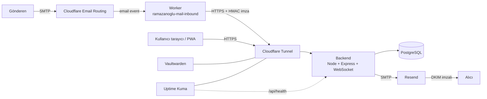
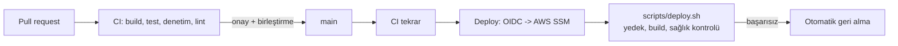

# Mimari

Ramazanoğlu Tech Mail HQ, şirket e-postasının tek doğruluk kaynağıdır. Gelen mail Gmail'e uğramaz.

## Bileşenler

| Bileşen | Görev | Nerede |
| --- | --- | --- |
| Backend (`cloud-backend`) | REST API, WebSocket, hesaplar, gelen mail kapısı, gönderim | EC2, Docker |
| PostgreSQL | Mailler, hesaplar, denetim kaydı | EC2, Docker, dışarıya kapalı |
| PWA (`mobile-pwa`) | Mail arayüzü ve yönetim paneli | Backend tarafından sunulur |
| Worker (`email-worker`) | Gelen maili imzalayıp backend'e iletir | Cloudflare |
| Cloudflare Tunnel | Sunucuyu port açmadan yayınlar | EC2'de `cloudflared` |
| Resend | Giden mail (SPF, DKIM) | Üçüncü taraf |
| Uptime Kuma | Çalışma izleme ve durum sayfası | EC2, Docker (`tools` profili) |
| Vaultwarden | Ortak şifre kasası | EC2, Docker (`tools` profili) |

## Gelen mail güvenliği

Worker her isteği `HMAC-SHA256(zaman damgası, alıcı, gönderen, ham mesaj)` ile imzalar. Backend imzayı,
zaman damgasını (5 dakika) ve alıcının şirket alan adında olmasını doğrular. Aynı mesajın tekrarı
(`Message-ID` + alıcı) ikinci satır oluşturmaz.

## Erişim ve yetki

Kişi bazlı hesaplar (`owner`, `admin`, `member`), alias bazlı yetki, hatalı girişte kilitleme,
denetim kaydı. Ayrıntı için `SECURITY.md` ve `docs/runbook.md`.

## Ortamlar

| Ortam | Amaç | Nasıl çalışır |
| --- | --- | --- |
| Canlı | Gerçek mail | `docker-compose.yml`, `main` dalı |
| Staging | Dalları denemek | `docker-compose.staging.yml`, ayrı veritabanı, gerçek mail kimlik bilgisi yok |
| Yerel | Geliştirme | `MOCK_MODE=true`, veritabanı gerekmez |

## Yayın hattı

Sunucuya SSH portu açılmaz; GitHub, AWS'ye OIDC ile kimliğini kanıtlar ve yalnızca belirli bir
sunucuda belirli komutu çalıştırabilir.
